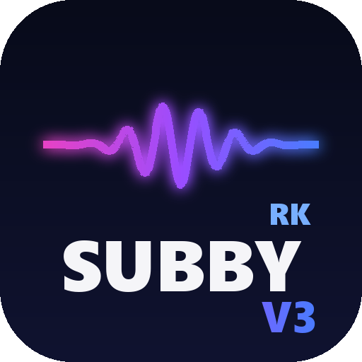
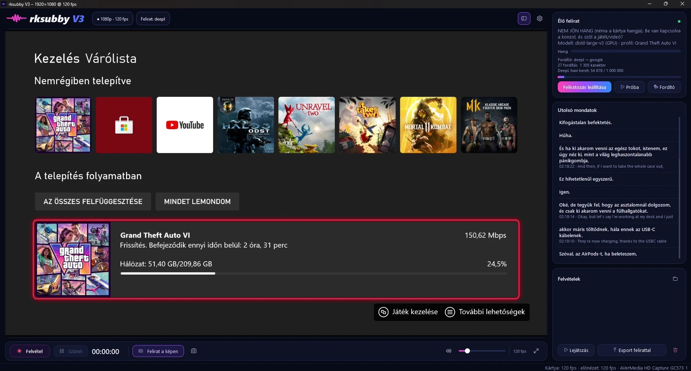

<p align="center"></p>

# rksubby V3 – Xbox/PS5-rögzítő élő magyar felirattal

> **English summary:** rksubby V3 is a lightweight, RECentral-style capture app for the Xbox (or any HDMI source) — and now for PC games and apps on the Windows desktop too — with live Hungarian subtitles. It shows the capture card's picture in its own window at up to **1080p120**, rendered on the GPU with almost no CPU load, records it with **NVENC** (HEVC or H.264 + AAC, crash-safe MP4) at the exact resolution and frame rate of the incoming signal, and turns English speech into Hungarian subtitles on the fly: Silero VAD + faster-whisper on the GPU, translated by DeepL, a local AI (Ollama) or Google. Subtitles are drawn on the picture, saved next to each recording as `.srt`, and can be burned into an exported copy. A source switch selects the capture card or a Windows monitor (DXGI Desktop Duplication + WASAPI loopback audio; subtitles appear in a click-through on-screen bar), and an automatic mode falls back to the desktop when the console is off. Everything is configured behind a single gear button. The all-in-one installer contains everything, including the CUDA libraries and the speech model; only the capture card driver is not included.

Az rksubby V3 már nem csak feliratoz: **a capture kártya teljes jelét kezeli**. Mutatja az Xbox képét 120 Hz-en, felveszi, és közben élőben magyar feliratot ír az angol beszédhez. Egy kattintással **a PC-n futó játékra, programra vagy videóra** is átállítható (Windows asztal). A RECentral, az OBS és a régi rksubbyV2 helyett egyetlen program.

<p align="center"></p>
<p align="center"><sub>Az Xbox képe 1080p · 120 fps-ben, alatta a felvétel vezérlői, jobbra az élő felirat (DeepL) és az utolsó lefordított mondatok.</sub></p>

## Újdonságok a V3-ban

- **Valódi 1080p120 előnézet.** A kép közvetlenül a videokártyán jelenik meg (Direct3D 11), a színátalakítás és a skálázás is ott történik. Mért érték: 119,9 fps a kártyáról és az előnézetben is, a processzor terhelése felvétel közben ~2%.
- **Felvétel a jelhez igazítva, beállítás nélkül.** 1080p120 jelből 1080p120 fájl, 4K60-ból 4K60. A program indításkor és jelváltáskor felismeri a felbontást és a képkockasebességet. NVIDIA NVENC kódolás (HEVC vagy H.264), AAC hang a kártyáról. Áramszünet vagy összeomlás után is lejátszható MP4.
- **Felirat a képen és a felvétel mellett.** Az élő felirat a képre kerül, és minden felvétel mellé `.srt` fájl készül (a VLC és az MPC magától betölti). Az **Export felirattal** gomb egy olyan változatot készít, amelybe a felirat bele van égetve.
- **Capture kártya vagy Windows asztal.** A fejléc forrásgombjával válthatsz: capture kártya (Xbox, PlayStation, bármilyen HDMI) vagy egy monitor képe és a gép hangja (PC-s játék, program, videó).
  - **Automatikus mód:** a kártya, ha van jele; ha az Xbox ki van kapcsolva, a Windows asztal. Ha közben bekapcsolod az Xboxot, magától visszavált.
  - Asztali módban a felirat a képernyő alján jelenik meg, minden ablak fölött (az egér átmegy rajta). Az rksubby saját ablaka nem kerül a felvételre.
  - Mért érték: 120 fps rögzítés és előnézet a 240 Hz-es monitorról, a felvétel 1920×1080 @ 120.
- **Új, egységes felület.** Sötétkék téma rózsaszín–lila–kék kiemeléssel. Középen a kép, alatta a felvétel vezérlői, oldalt az élő felirat, az utolsó mondatok és a felvételek listája.
- **Minden beállítás egy fogaskerék mögött.** Fordító (DeepL, Lokális AI, Google, nincs), DeepL-kulcs beillesztése és ellenőrzése, beszédfelismerő modell, felirat kinézete, felvételi mappa és minőség, capture kártya, hang.
- **Minden az egyben telepítő.** Python, Qt, FFmpeg, SDL2, faster-whisper, az NVIDIA CUDA-könyvtárak és a beszédfelismerő modell is benne van, a telepítés után semmit nem kell letölteni. Rendszergazdai jog nem kell, és a Gépház › Alkalmazások alól eltávolítható.
- **Frissítés-értesítő.** Ha új kiadás jelenik meg a GitHubon, a fejlécben megjelenik az „Új verzió” gomb (a beállításokban kikapcsolható).
- **Egy példány.** A második indítás az elsőt hozza előre, így nem veszik el egymástól a kártyát.
- **Biztonság.** A kártyát kizárólag a szabványos DirectShow-úton nyitja meg (mint az OBS). Gyártói, nem dokumentált driver-hívást nem használ.

## Letöltés és telepítés

1. Töltsd le a **[Releases](https://github.com/rknoise/RKSUBBYV3/releases)** oldalról **mind a három fájlt** ugyanabba a mappába:
   - `rksubby_V3_Setup.exe`
   - `rksubby_V3_Setup-1.bin`
   - `rksubby_V3_Setup-2.bin`

   A telepítő a modellel együtt ~2,4 GB, a GitHub viszont fájlonként legfeljebb 2 GB-ot enged, ezért több részből áll.
2. Futtasd a `rksubby_V3_Setup.exe`-t. Kb. 4 GB helyet foglal, rendszergazdai jog nem kell.
3. Indítsd az asztali **rksubby V3** ikonnal.

Minden benne van, a beszédfelismerő modell (distil-large-v3) is: a telepítés után semmit nem kell letölteni. Más modellt (pl. large-v3-turbo) a program első használatkor tölt le. A régi V2 beállításait (DeepL-kulcs, játékprofil, felirat stílusa) a V3 magától átveszi, mert ugyanabban a mappában vannak: `%USERPROFILE%\.rksubby`.

**Amit a telepítő nem tud feltenni:** a capture kártya illesztőprogramját (pl. AVerMedia GC573 a gyártó oldaláról). Ha nem találja a kártyát, a telepítő szól.

## Kezelés

| | |
|---|---|
| **F9** | felvétel indítása / leállítása |
| **F10** | szünet / folytatás (a felvétel és az időzítő is megáll) |
| **F8** | felirat a képen be/ki |
| **F11** vagy dupla kattintás | teljes képernyő, **Esc**: vissza |
| **F12** | pillanatkép (PNG, a felvételek mappájának `Képek` almappájába) |
| **F5** | jel újrafelismerése |

- **Forrásgomb** (a fejlécben, a logó mellett): Automatikus / capture kártya / Windows asztal (monitoronként).

- **Élő felirat panel:** állapot, hangszint, fordító és DeepL-keret, a feliratozás indítása és leállítása.
- **Utolsó mondatok:** a magyar felirat és alatta az angol eredeti, időponttal.
- **Felvételek:** lejátszás, mappa megnyitása, **Export felirattal**, Lomtárba helyezés (megerősítés után, visszaállítható).

## Beállítások (fogaskerék)

- **Fordítás:** DeepL (a legjobb minőség, kulcs kell), **Lokális AI** (Ollama a saját gépeden, semmi nem megy ki), Google (ingyenes, kulcs nélkül) vagy fordítás nélkül (angol felirat).
  - A DeepL-kulcsot beillesztheted, és egy kattintással ellenőrizheted, ilyenkor a havi keretet is látod.
  - Állítható a hangnem (tegező vagy magázó) és a játékprofil szótára (glosszárium).
  - Tartalék fordító: ha a választott nem elérhető, a felirat akkor is magyar marad.
- **Beszédfelismerés:** modell (distil-large-v3 az ajánlott, a large-v3-turbo pontosabb), GPU vagy processzor, játékprofil (GTA V, GTA VI, RDR2, általános), angol előnézet, a mondat végét jelző csend hossza, automatikus indulás.
- **Felirat:** betűméret, szín, háttérdoboz, sorok száma, pozíció. OBS böngészőforrás-felirat is kérhető: `http://127.0.0.1:8765/`.
- **Felvétel:** mappa (alapértelmezett: `Videók\rksubby`), minőség (normál, magas, maximális), kódolás (HEVC vagy H.264), SRT mentése.
- **Kép és hang:** forrás (automatikus, capture kártya, Windows asztal), a kártya és a monitor kiválasztása, asztali fps (60 vagy 120), a képernyőn lévő felirat a felvételre is kerüljön-e, a játék hangja szóljon-e a gépen.

### DeepL-kulcs

1. Regisztrálj a DeepL API Free csomagra: <https://www.deepl.com/pro-api> (havi 500 000 karakter ingyen).
2. Másold ki a kulcsot: <https://www.deepl.com/your-account/keys>. A Free kulcs vége `:fx`.
3. Fogaskerék › Fordítás › **Beillesztés**, majd **Ellenőrzés**.

A kulcs a felhasználói mappádba kerül (`%USERPROFILE%\.rksubby\deepl_key.txt`), nem a programmappába.

### Lokális AI (Ollama)

Telepítsd az [Ollamát](https://ollama.com), majd parancssorban: `ollama pull translategemma:12b`. A fogaskerék › Fordítás oldalon válaszd a **Lokális AI**-t, és nyomd meg az **Ellenőrzés** gombot. A szöveg ilyenkor nem hagyja el a gépet.

## Hogyan működik

```
Xbox ─HDMI─> capture kártya (DirectShow, egy csatorna: kép + hang)
               │
               ├─ kép (NV12) ──> előnézet: SDL2 + Direct3D 11 a Qt-ablakban ──> felirat a képen
               ├─ kép + hang ──> NVENC (HEVC/H.264) + AAC ──> .mp4  (+ .srt a felirattal)
               └─ hang ──┬──> hangszóró
                         └──> Silero VAD ─> faster-whisper (GPU) ─> DeepL / Lokális AI / Google ─> magyar felirat

PC-s játék ─> Windows asztal: DXGI Desktop Duplication (kép, BGRA) + WASAPI loopback (a gép hangja)
               └─ ugyanaz, mint fent; a felirat a képernyő alján, minden ablak fölött
```

Asztali módban a kép a Windows dokumentált képernyő-rögzítőjéből jön, ugyanabból, amit az OBS „Kijelző rögzítése” használ. A játékba nem nyúl bele (nincs injektálás), így csalásvédelmet nem zavar. A színátalakítást (BGRA → YUV) az NVENC végzi a videokártyán.

**Jelfelismerés:** a kártya bármilyen kért formátumra skáláz, ezért a program a ténylegesen beérkező képet méri. A felbontást abból ismeri fel, hogy melyik módban (4K, 1440p, 1080p) van még valódi finom részlet a képben. Az fps-t a képkockák beérkezési üteméből méri: a kártya nem gyárt képkockát, így 60 Hz-es jelből 120-ra kérve is csak 60 érkezik. A felirat a tartalom ütemét sosem használja, mert egy 60 fps-es játék 120 Hz-es jelben is lehet. Jelváltáskor (az Xbox a HDMI-t újraszinkronizálja) magától újramér.

## Mért teljesítmény

RTX 3090, Ryzen 7 7800X3D, AVerMedia Live Gamer 4K (GC573), Xbox Series (2026. november):

| | |
|---|---|
| Előnézet 1080p120 jelnél | **119,9 fps** (a kártyáról 119,9 fps) |
| Windows asztal (240 Hz-es monitor) | 120 fps rögzítés és előnézet, felvétel 1920×1080 @ 120 (1788 képkocka / 14,94 s) |
| Felvétel 1080p120 (ffprobe) | HEVC 1920×1080, `r_frame_rate=120/1`, 1763 képkocka / 14,71 s, 0 eldobott |
| Processzorterhelés felvétel közben | ~2% (az egész gépre vetítve) |
| Mondat vége → magyar felirat (V2-es mérés, DeepL) | ~0,8 mp (medián) |
| Feliratozó indulása (modell a gyorsítótárban) | ~7 mp |

## Követelmények

- Windows 10 (1809+) vagy 11, 64 bites
- Capture kártya illesztőprogrammal. Az AVerMedia Live Gamer 4K (GC573) kipróbált; más DirectShow-os kártya is működhet.
- NVIDIA videokártya ajánlott (felvétel NVENC-cel, gyors felismerés, 6+ GB VRAM). Nélküle is elindul: a felvétel processzorral kódol, a felismerés lassabb.
- Fordításhoz internet (DeepL vagy Google), vagy Ollama a lokális AI-hoz

## Hibaelhárítás

**„A kártya nem nyitható meg”.** A kártyát egyszerre egy program használhatja: zárd be a RECentralt, az OBS-t és a régi rksubbyV2-t. A V3 pár másodpercenként magától újrapróbálja.

**„Nincs jel”.** Be van kapcsolva az Xbox? Jó a HDMI-kábel? Az Xbox 120 Hz-hez: Beállítások › Általános › TV és megjelenítés › Frissítési gyakoriság: 120 Hz.

**60 fps-t mutat 120 helyett.** Az Xbox csak akkor küld 120 Hz-et, ha a játék vagy a menü támogatja. Sok játék 60 Hz-re váltja a jelet, ilyenkor a felvétel is 60 fps lesz. Ha az Xbox visszavált, a program magától újramér (vagy nyomd meg az F5-öt).

**Nem jön hang / „NEM JÖN HANG”.** Szól a játék? A panel hangszintjelzőjének mozognia kell. Egy másik program is használhatja a kártyát.

**Asztali módban nem látszik a felirat a játék fölött.** A kizárólagos teljes képernyős játékok mindent eltakarnak: állítsd a játékot **keret nélküli ablak** (borderless) módra. A felirat a felvétel mellé mentett `.srt`-ben ilyenkor is megvan.

**Lassú vagy hiányzó felirat.** Fogaskerék › Beszédfelismerés: GPU legyen kiválasztva. Az első indításkor a modell letöltése pár percig tart.

**DeepL-hibák.** 403: rossz a kulcs. 456: elfogyott a havi keret, ilyenkor a tartalék fordító (Lokális AI vagy Google) dolgozik.

Napló: `%USERPROFILE%\.rksubby\rksubby.log` (Fogaskerék › Névjegy › Naplómappa).

## Fejlesztőknek

```bat
uv venv --python 3.12 .venv-v3
uv pip install --python .venv-v3\Scripts\python.exe -r requirements.txt
.venv-v3\Scripts\python.exe rksubby.py
```

Tesztek: `.venv-v3\Scripts\python.exe -m unittest discover -s tests`
Telepítő építése (Inno Setup 6 kell: `winget install JRSoftware.InnoSetup`): `.venv-v3\Scripts\python.exe tools\build_v3.py`, az eredmény: `dist\rksubby_V3_Setup.exe`.

```
rksubby.py            indító
rkv3/                 V3: felület és rögzítő
  app.py              főablak, vezérlés (kártya, felvétel, feliratozó, felvételek)
  capture.py          kártyakeresés, jelfelismerés, élő kép + hang, NVENC-felvétel
  desktop.py          Windows asztal mint forrás (DXGI + WASAPI loopback)
  video.py            GPU-s előnézet (SDL2/D3D11 a Qt-ablakban), felirat rajzolása
  settings.py         beállítások (fogaskerék)
  export.py           feliratos (beégetett) export
  theme.py, icons.py  kinézet
subby/                a feliratozó motor (V2-ből): VAD, faster-whisper, fordítók, feliratállapot, OBS-szerver
profiles/             játékprofilok (nevek, glosszárium)
installer/            Inno Setup szkript, OLVASS_EL.txt
tools/                build_v3.py, make_assets.py
```

## Adatvédelem

A beszédfelismerés helyben fut. Csak a felismert angol szöveg megy a fordítóhoz (DeepL vagy Google). Lokális AI esetén semmi nem hagyja el a gépet. A `sub_log.tsv` a felhasználói mappában helyben tárolja a felismert mondatokat; a beállításokban kikapcsolható.

## Felhasznált projektek

[faster-whisper](https://github.com/SYSTRAN/faster-whisper) és [CTranslate2](https://github.com/OpenNMT/CTranslate2) (MIT), [Whisper](https://github.com/openai/whisper) / [distil-whisper](https://github.com/huggingface/distil-whisper) modellek, [Silero VAD](https://github.com/snakers4/silero-vad) (MIT), [FFmpeg](https://ffmpeg.org) és [PyAV](https://github.com/PyAV-Org/PyAV) (LGPL), [SDL2](https://libsdl.org) (zlib), [DXcam](https://github.com/ra1nty/DXcam) (MIT), [PyAudioWPatch](https://github.com/s0d3s/PyAudioWPatch) (MIT), [Qt for Python / PySide6](https://www.qt.io/qt-for-python) (LGPL), NVIDIA CUDA-könyvtárak (cuBLAS, cuDNN – NVIDIA-licenc), [DeepL API](https://www.deepl.com/pro-api), [Ollama](https://ollama.com), [Inno Setup](https://jrsoftware.org/isinfo.php).
A `teszt_angol.wav` J. F. Kennedy 1961-es beiktatási beszédéből származik (közkincs). Az Xbox a Microsoft védjegye; az rksubby független, nem hivatalos program.
